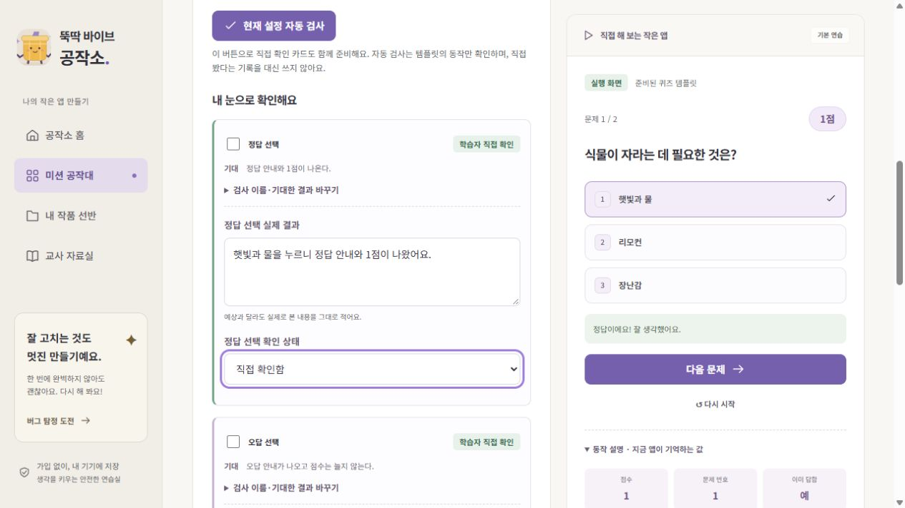

# 학생·교사 관점 UX 개선

2026-10-25. 배포된 웹앱을 브라우저 UI로 직접 조작하며 학생의 첫 퀴즈 미션과 교사의 수업 준비 동선을 체험했습니다. 실제 학생·교사가 참여한 사용성 연구나 학교 기기 검증은 아닙니다. 검수용 작품에는 학생 개인정보를 넣지 않았습니다.

## 직접 발견한 불편과 변경

| 상황 | 체험에서 발견한 문제 | 개선 |
|---|---|---|
| 첫 작품의 목표 | 아무것도 확인하지 않았는데 예시 문구가 채워져 목표가 완료로 표시됨 | 시작 예시임을 알리고 ‘이 약속으로 만들기’로 확인한 뒤 완료. 약속을 수정하면 다시 확인 |
| 예상 작성 | 다른 단계에서도 실행할 수 있어 무엇을 먼저 해야 하는지 불명확. 실행한 뒤 예상을 적어도 이전 실행 기록이 인정될 여지 | ‘먼저 예상 적기’로 해당 입력란에 초점 이동. 예상 전 실행은 연습할 수 있지만 예상 기록의 실행으로 인정하지 않음. 예상 수정 후 재실행 필요 |
| 실행→검사 이동 | 1점을 본 뒤 검사 단계로 가면 실행 화면이 0점으로 초기화됨 | 퀴즈 점수·응답과 이야기 장면을 같은 작품의 단계 이동에서 유지. 설정 변경·작품 재열기·버전 복원은 초기화하며 타이머 정리는 유지 |
| 검사 시작 | 자동 검사와 직접 카드 준비를 각각 찾아 눌러야 했고 다음 할 일이 모호함 | 자동 검사 한 번으로 직접 확인 카드도 함께 준비. 3단계 안내와 자동/직접 진행 상태 표시 |
| 검사 화면의 부담 | 자동 검사 4개가 직접 기록보다 먼저 길게 나오고, 카드마다 이름·기대 결과까지 반복 편집. 별도 수정 칸 7개 노출 | 직접 관찰 카드를 먼저 표시. 이름·기대 결과 편집과 통과한 자동 결과를 접고, 수정은 핵심 두 칸(동작·이유)을 먼저 표시. 상세 요청과 추가 카드는 펼침 메뉴 |
| 같은 설정 재검사 | 누를 때마다 같은 자동 결과가 중복 추가됨 | 현재 설정의 자동 결과를 갱신. 직접 관찰의 값·판정·ID, 이전 설정의 검사와 저장 버전은 유지 |
| 교사 차시 준비 | 5차시를 읽은 뒤 미션 목록에서 중복 점수 미션을 다시 찾아야 함 | 8차시 각각 연결 미션 안내와 학생용 주소 복사 제공. 학습 기록 없이 미션 식별 정보만 공유 |
| 교사 검사표 | 프로젝트 구분 없이 행이 나열되고 기대 결과도 모두 빈칸. 좁은 화면에서 표 전체가 넘칠 수 있음 | 프로젝트 필터와 정상 규칙의 기대 결과 예시. 실제 결과는 관찰 후 직접 기록. 표 안에서만 가로 이동 |
| 표의 키보드 접근 | 모바일 표를 영역 안으로 제한한 뒤 자동 접근성 검사에서 가로 스크롤 영역이 키보드로 선택되지 않는 문제 검출 | 표 영역에 이름·포커스·초점 테두리를 제공하여 방향키 이동 가능 |
| 포트폴리오 읽기 | 무작위 설정 ID와 JSON 전체가 인쇄되어 학생 설명보다 구현 데이터가 눈에 들어옴 | 현재 편집본/저장 버전 이름, 문항 수·채점·초기화·장면 연결·시간 규칙을 쉬운 문장으로 표시. 원본 데이터는 선택해서 펼치고 인쇄에서는 제외 |

## 보존한 범위

- 스키마 버전, IndexedDB 이름·키, 작품 ID, 원문·정리 요청·예상·검사·성찰·버전 형식 유지
- 약속 확인은 선택적 `goalReviewed` 필드로 확장. 새 작품은 미확인으로 시작하고, 필드가 없는 옛 기록은 기존 완료 상태를 유지
- 가져오기에서 새 필드가 있으면 참/거짓 자료형 검사. 없는 구형 파일과 기존 버전도 그대로 읽음
- 퀴즈·이야기·타이머의 실행 규칙, 실제 AI 기록 분리, 저장 실패·삭제 확인·파일 검증·앱 전용 저장 범위 유지
- 문장의 의미·창의성·이해도 자동 채점 없음. 기록이 채워진 것과 실제 학생의 이해도·교사 승인·외부 AI 실행을 구별

## 변경 파일

- `src/Workspace.tsx`: 약속 확인, 예상 바로가기와 재실행, 실행 상태 유지, 간소화한 수정 입력
- `src/Inspection.tsx`: 검사 순서·준비·직접 관찰·결과 요약·펼침 편집
- `src/engines.ts`: 직접 카드 준비와 중복 없는 재검사. 실행기의 상태 전이 규칙은 유지
- `src/learning.ts`: 예상 변경 상태, 사람이 읽는 설정과 버전 이름
- `src/model.ts`, `src/storage.ts`: 선택적 확인 필드와 구형 데이터 호환
- `src/Pages.tsx`, `src/App.tsx`: 교사 차시 연결·주소 복사·프로젝트 검사표
- `src/Portfolio.tsx`, `src/styles.css`: 규칙 요약, 인쇄, 좁은 화면과 키보드 표 접근
- `tests/`: 약속 확인·예상 재실행·관찰 보존·구형 파일·교사 동선·인쇄 회귀 검사 추가

## 검증

핵심 자동 테스트 **22개 통과**, 로컬 실제 빌드 대상 브라우저 시나리오 **19개 통과(59.6초)**, 프로덕션 빌드 성공을 확인했습니다. 학생 UI에서 약속 확인, 예상 입력 바로가기의 초점, 1점 상태의 검사 단계 유지, 자동·직접 카드 동시 준비를 직접 재체험했습니다. 교사 UI에서 5차시를 펼쳐 연결 미션으로 이동했습니다.

개선 앱의 커밋은 [`1f82890487207a93bad28f7d717997fd9f9b031e`](https://github.com/gmlduqzhd123-lab/Vibe-for-U/commit/1f82890487207a93bad28f7d717997fd9f9b031e)입니다. [Pages 배포 40192890081](https://github.com/gmlduqzhd123-lab/Vibe-for-U/actions/runs/40192890081)의 성공을 확인한 뒤 **실제 공개 주소에서 19개 시나리오를 모두 통과했습니다(45.1초).**

| 확인 | 결과 |
|---|---|
| GitHub 커밋·원격 푸시·Pages 배포 | 성공 |
| 실제 공개 주소 HTTP | 200 |
| 공개 JS·CSS와 로컬 빌드의 SHA-256 비교 | 둘 다 일치 (`index-BTFkKXX9.js`, `index-BeBj8AFD.css`) |
| 기존 배포에서 만든 검수 작품 다시 열기 | 제목·예상·기존 검사 보존 확인 |
| 공개 UI에서 직접 실행·관찰 기록·확인 상태 작성 | 1점 실행, 직접 관찰 1/2개 기록 확인 |
| 새 약속 확인·예상 재실행·단계 상태·한 번에 검사 준비 | 회귀 검사 통과 |
| 교사 차시 연결·미션 주소·검사표 필터·360px·키보드 표 접근 | 회귀·접근성 검사 통과 |
| 인쇄용 포트폴리오 | 3페이지 PDF를 PNG로 렌더링해 확인. 규칙 요약 포함, JSON의 `scoring`·`questions` 원본 데이터 제외 확인 |
| 초기 퀴즈·이야기·타이머·저장 실패·파일·삭제·모드·키보드 흐름 | 공개 회귀 검사 통과 |

후속 문서 커밋은 이 검증 기록과 화면 증거만 추가하며 앱 실행 코드는 바꾸지 않습니다.



```powershell
npm test
npm run build
npm run test:e2e
npx playwright test -c playwright.public.config.ts
```

실제 학교 기기·학생·교사 수업 운영·Safari·물리 프린터 검증은 남아 있습니다. 반응형 검사는 Windows Edge에서 화면 크기를 에뮬레이션한 결과이며, 실제 AI 도구의 생성·실행을 대신하지 않습니다.
