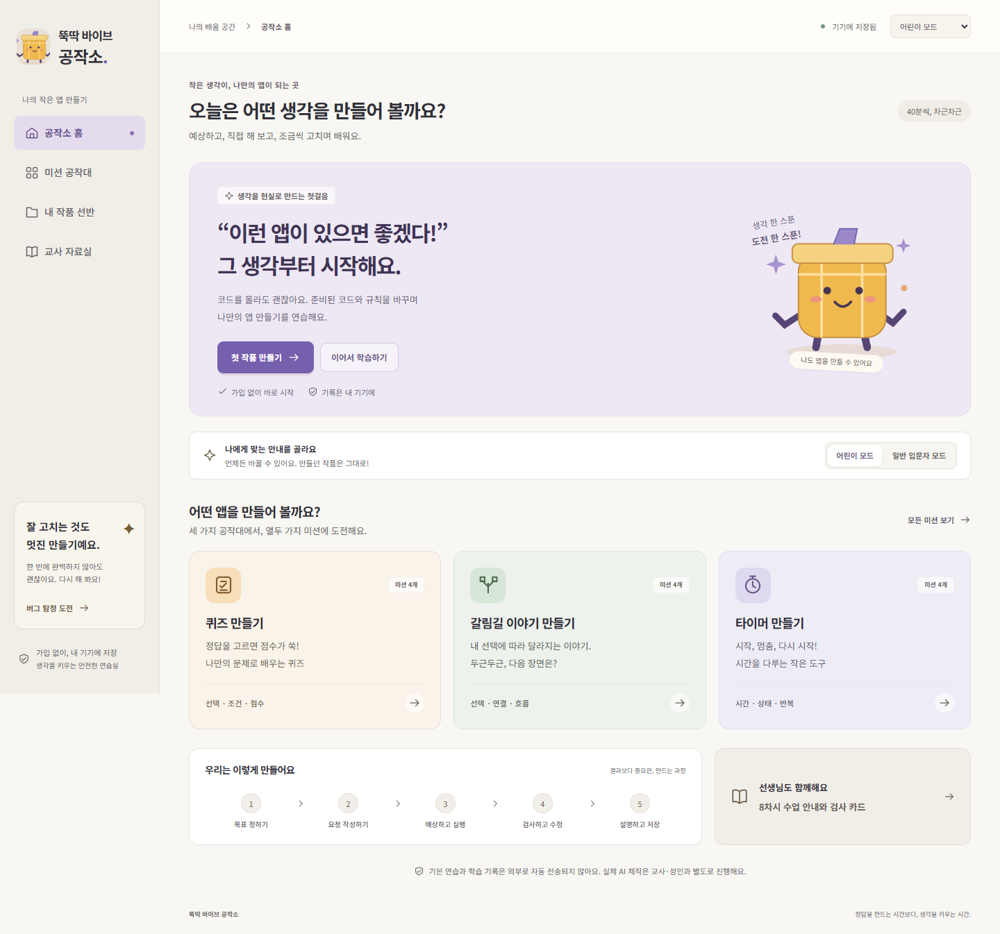
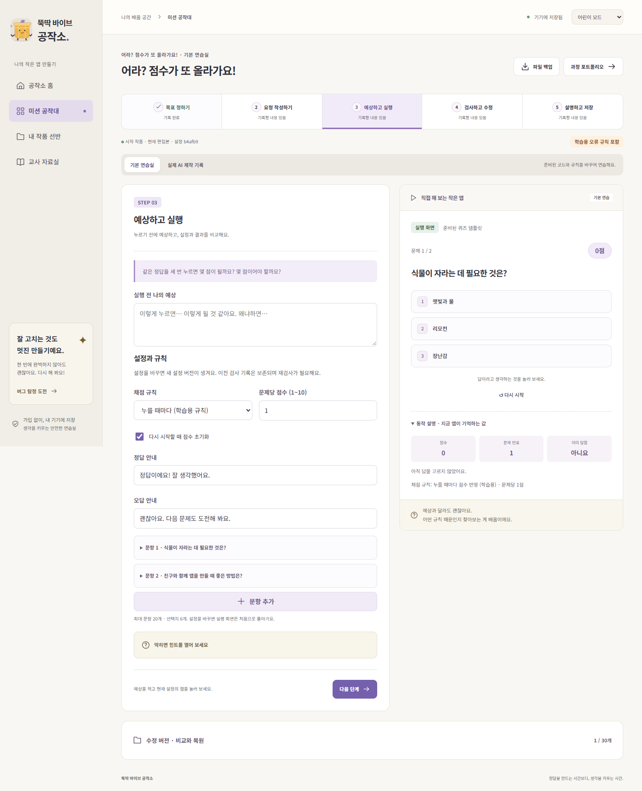

# 구현·검증 결과

이 문서는 최초 로컬 구현 완료 시점의 기록입니다. 이후 사용자가 지정한 `gmlduqzhd123-lab/Vibe-for-U` 저장소에 연결하고 Pages에 배포했습니다. 최신 원격·배포·공개 검증 상태는 [GitHub 연동 기록](GITHUB-연동.md)을 확인하세요. 아래의 커밋·배포 미실행 표시는 연동 전 상태입니다.

검증일: 2026-10-25, 한국 시간. 새로운 빈 폴더에서 작업했으며 적용되는 상위 `AGENTS.md`, 기존 코드·Git 메타데이터·브랜치·원격 주소·Actions·배포 주소는 발견되지 않았습니다. 기존 파일이나 사용자 변경을 덮어쓰지 않고 독립된 `outputs/ttukttak-vibe`에 구현했습니다.

## 구현한 기능

- Vite + React + TypeScript 정적 웹앱. 가입·서버·API 키 설정 없이 기본 과정 이용
- 시작·12개 미션·만들기 약속·작업실·검사와 수정·작품 선반·버전 비교·포트폴리오·교사 자료실
- 퀴즈: 정답/오답, 점수, 다음 문제, 결과, 재시작. 중복 채점과 점수 초기화의 학습용 규칙
- 이야기: 장면·선택·결말 편집, 연결 수정, 결말 도달 검사, 시작으로 복귀
- 타이머: 시작·일시정지·재개·초기화, 종료 한 번, 0초 하한, 절대 시각으로 경과 반영, 화면 이동 때 정리, 다시 열 때 정지
- 어린이·일반 입문자 모드, 같은 데이터 유지, 단계별 힌트와 상태 변화 설명
- 원문과 정리 요청문, 수정 요청문, 실제 복사 결과와 실패 시 직접 선택 대안
- 기본 연습과 별도 실제 AI 사용 기록. 도구·예상·검사·관찰 없이 복사만으로 완료 처리하지 않음
- 자동 검사 / 학습자 직접 검사 / 친구·교사 의견 / 미확인 구분. 설정 버전에 검사 연결, 직접 검사 작성·선택 삭제
- IndexedDB 자동 저장, 명시적 버전 저장·비교·복원·삭제. 복원 전 편집본 보존
- JSON 백업·분할·가져오기. 모든 버전의 필드·참조 검사, 새 ID 복사, 트랜잭션 저장
- 저장 실패 때 편집 유지·성공 표시 금지·재시도·파일 백업
- 작품 / 선택 기록 / 앱 전체 삭제 대상 확인과 백업, 다음 사용자 시작, 다른 앱 저장소 보존
- 실제 기록을 모은 포트폴리오와 인쇄 스타일, 공개 8차시 자료·검사표·짝 활동·과정 평가표
- 상대 자산 경로·해시 라우팅, 수동 GitHub Pages Actions 워크플로

## 주요 파일과 변경 이유

| 파일 | 구현 목적 |
|---|---|
| `src/model.ts` | 공유 스키마와 제한, 요청문 정리, 단계 기록 상태, 정상/학습용 새 작품 |
| `src/data.ts` | 12개 미션별 목표·시작 데이터·예상·검사·수정·힌트·완료·마무리와 8차시 자료 |
| `src/engines.ts` | UI와 검사가 같은 상태 전이 규칙을 사용. 재현 가능한 학습용 설정 |
| `src/storage.ts` | 저장 성공 판정, 엄격한 가져오기, 크기별 백업 분할, 앱 저장소 범위 |
| `src/App.tsx` | 경로·저장 큐·모드·파일·삭제·복원·클립보드 실패 처리 |
| `src/Workspace.tsx` | 다섯 학습 단계와 직접 검사·수정 이유·AI 기록·버전 비교 |
| `src/Preview.tsx`, `src/Settings.tsx` | 세 실행기 UI·허용 설정과 현재 상태 설명 |
| `src/Pages.tsx`, `src/Portfolio.tsx` | 홈·미션·작품·자료·과정 기록과 인쇄 |
| `src/ui.tsx`, `src/styles.css`, `public/favicon.svg` | 로컬 SVG, 입력 라벨, 키보드 포커스, 반응형·모드·인쇄 디자인 |
| `tests/core.test.ts`, `tests/e2e.spec.ts` | 상태 규칙·저장·파일 검증과 실제 브라우저 사용자 흐름 |
| `.github/workflows/pages.yml` | 기본 브랜치를 추측하지 않는 수동 Pages 배포 준비 |

## 실행 결과

실제 `dist/`를 `http://127.0.0.1:4173/pages-check/`에서 제공하고 Windows Microsoft Edge의 격리된 브라우저 컨텍스트로 검사했습니다. 실제 사용자의 브라우저 프로필이나 저장소를 테스트에 사용하지 않았습니다.

| 명령 | 결과 | 근거 |
|---|---|---|
| `npm run build` | 통과 | TypeScript 검사와 Vite 프로덕션 빌드 완료 |
| `npm test` | 통과 | 핵심 자동 테스트 **17개** |
| `npm run test:e2e` | 통과 | 실제 Edge 브라우저 시나리오 **16개** |
| `npm audit` | 통과 | 실행 시점 전체 의존성 취약점 0건 |
| `npm audit --omit=dev` | 통과 | 실행 시점 제품 의존성 취약점 0건 |

처음 설치 때 테스트 도구의 취약점이 보고되어 Vitest 5.0.5로 올렸습니다. 이후 전체 및 제품 의존성 감사에서 0건을 확인했습니다. 버전은 `package-lock.json`에 고정됩니다.

## 항목별 검증

| 항목 | 판정 | 확인한 증거와 범위 |
|---|---|---|
| 첫 방문·가입 없는 시작 | 통과 | 홈 첫 작품 버튼으로 퀴즈 1 진입 |
| 모드 전환·기록 보존 | 통과 | 실제 1점 상태, 예상·원문 유지, 새로고침 후 모드 복원 |
| 중복 점수 재현·수정 | 통과 | 동일 정답 세 번: 학습 규칙 3점 → 정상 규칙 1점. 수정 전후 자동·직접 검사 저장 |
| 퀴즈 정상 동작 | 통과 | 오답 0점, 정답 1점, 마지막 결과, 재시작 0점·1번·미응답 |
| 이야기 연결·결말 | 통과 | 잘못된 유효 연결을 실행, 햇살 정원으로 수정, 두 결말 방문·처음으로 복귀 |
| 이야기 자동 검사 | 통과 | 도달 불가 결말 검출, 수정 후 모든 의도한 결말 도달 |
| 타이머 | 통과 | 연속 시작 차단, 3초→2초, 멈춤 유지, 재개, 시간 도약 후 0초·안내 한 번, 초기화 |
| 화면 이동·정지 복원 | 통과 | 타이머 실행 중 선반으로 이동·시간 경과·재진입 후 설정 시간의 정지 상태. 소스의 interval·visibility 이벤트 정리 확인 |
| 예상·이유·성찰 저장 | 통과 | 입력 후 저장 완료, 새로고침으로 같은 값 복원 |
| 버전 비교·복원·삭제 | 통과 | 수정 전 검사 버전 저장, 이전 규칙 복원 후 2회 클릭 2점, 복원 전 편집본 보존, 지정 버전 삭제 후 실행 상태 유지 |
| 검사 출처·현재 버전 | 통과 | 자동/직접/의견 UI 구분, 예전 설정 기록으로 현재 완료 처리하지 않는 단위 테스트 |
| 직접 검사·기록 삭제 | 통과 | 검사 이름·기대·실제·판정 작성, 대상 확인 뒤 선택 검사만 삭제 |
| JSON 왕복 | 통과 | 내려받은 파일을 다시 선택해 새 ID 복사본 두 작품 확인, 설정·전체 기록 동일성 단위 검사 |
| 손상·비지원 가져오기 | 통과 | 손상 JSON·다른 스키마·잘못된 필드·길이·범위·개수·장면 참조 거절, 기존 작품 보존 |
| 큰 백업·버전 한계 | 통과 | 51작품 및 2MB를 넘는 큰 작품 목록을 각각 유효한 파일들로 분할·복원, 600KB 넘는 버전 묶음 거절 |
| 저장 실패 | 통과 | 테스트에서 `put`에 QuotaExceededError 주입. 실패 안내·입력 유지·JSON 내보내기 내용 확인. 실제 디스크를 가득 채우지 않았음 |
| 삭제 범위·다음 사용자 | 통과 | 이전 기록 자동 연결 해제·명시적 열기, 작품 삭제·전체 삭제 후 다른 앱의 localStorage와 별도 IndexedDB 값 유지 |
| 외부 AI 활동 구분 | 통과 | 복사만으로 미기록 상태 유지. 도구·예상·검사·관찰·사용자 판정 뒤 관찰 기록 상태. 외부 도구의 실제 생성은 수행하지 않음 |
| 복사 실패 대안 | 통과 | 클립보드 실패를 주입하고 직접 선택 대화상자·전체 선택·Escape 닫기 확인 |
| 미션·교사 자료 | 통과 | 12미션·8차시 표시, 인쇄용 검사 카드와 네 항목·세 단계 평가표, 미션 해시 새로고침 |
| 반응형 | 통과 | 360×640, 768×1024, 1440×1000 에뮬레이션. 홈·작업실의 전체 문서 가로 넘침 없음. 스크린샷 확인 |
| 키보드 | 통과 | Tab→본문 건너뛰기→시작→제목 편집→단계 버튼 Enter 이동. 포커스 표시와 native dialog 사용 |
| 자동 접근성 | 통과 | axe의 WCAG 2 A/AA 및 2.1 AA 규칙으로 세 크기 홈·작업실, 다른 단계·선반·포트폴리오·자료실·미션·삭제 대화상자 검사. 검출 위반 0. 전체 접근성 인증이나 스크린리더 실기기 평가를 뜻하지 않음 |
| 런타임 외부 요청 | 통과 | 홈→작업실 실행에서 외부 요청 0. 소스에 외부 CDN·분석·백엔드 호출 없음 |
| 안전한 문자열 표시 | 통과 | HTML 모양 원문 유지·React 텍스트 표시, 소스에 사용자 입력의 eval/new Function/HTML 삽입 없음 |
| 포트폴리오 인쇄 | 통과 | 실제 기록으로 A4 PDF 출력, 메뉴·편집 버튼 숨김, 네 페이지를 PNG로 렌더링해 한글·표·버전 기록 검수 |
| 교사 수업안 인쇄 | 통과 | 접힌 차시도 인쇄 전에 펼침. 5페이지 PDF에서 교사 발문·기기 문제 대안 각각 8개 확인, 렌더링 검수 |
| 하위 경로·새로고침 | 통과 | 실제 빌드 자산을 `/pages-check/`에서 읽고 미션·작품 해시 경로 재로드 |
| 실제 공개 URL | **미실행** | Git 저장소·원격·배포 URL이 없어서 공개 서비스에 배포하지 않음 |
| 실제 학교 기기·휴대전화·Safari | **미실행** | Windows Edge의 화면 크기 에뮬레이션만 수행 |
| 물리 프린터·수업 운영 | **미실행** | PDF 검수만 수행. 실제 출력과 교사·학생 운영 검증은 별도 |

최종 검사에서 남은 실패 항목은 없습니다. 브라우저 검사는 `playwright-report/index.html`로 재생성할 수 있으며 HTML 보고서와 trace는 배포 산출물에 포함하지 않습니다.

## 수정한 주요 문제

1. 보조 문구 대비 부족: 텍스트 색을 진하게 조정하고 주요 설명·입력 글자를 확대한 뒤 접근성 재검사.
2. 입력 라벨 연결: 텍스트 영역의 값과 라벨이 섞이지 않도록 고유 ID와 명시적 label 연결 적용.
3. 같은 설정 버전 재복원: 실행 컴포넌트의 복원 키를 갱신하여 같은 버전을 다시 열어도 초기·정지 상태가 되도록 처리.
4. 큰 기록 백업: 파일을 크기·작품 수 기준으로 분할하고, 버전 묶음 제한과 개별 삭제·안내를 추가.
5. 직접 확인 없이 자동 검사만으로 완료될 여지: 직접 관찰 기록을 검사 단계의 완료 조건에 포함.
6. 접힌 교사 수업안 인쇄: 인쇄 직전에 모든 차시를 펼치고 인쇄 후 원래 펼침 상태로 복원.

## 제약과 배포 상태

- 임의 앱 코드 생성·실행, 로그인·개인별 보호·여러 탭 충돌 병합, 실시간 공동 편집, 서버 진도 수합, 작품 URL 발행은 지원하지 않습니다.
- 기본 기능의 런타임에는 외부 네트워크 서비스가 필요하지 않지만, 처음 페이지를 받기 위한 연결과 브라우저 로컬 저장 허용이 필요합니다. 오프라인 설치·서비스 워커는 포함하지 않았습니다.
- 기록이 입력되어 있다는 사실과 실제 학생의 이해도·교사 승인·외부 AI 실행의 진위를 자동으로 동일시하지 않습니다.
- 저장소명·배포 URL은 미확정입니다. GitHub Pages 설정·워크플로는 준비했으나 해당 GitHub 계정 설정·Actions 실행·실제 공개 URL은 미검증입니다.

| 단계 | 상태 |
|---|---|
| 로컬 구현 | 완료 |
| 로컬 테스트·프로덕션 빌드 | 완료 |
| 로컬 하위 경로 실행 | 확인 |
| Git 커밋 | 미실행 — Git 저장소 없음 |
| 원격 푸시 | 미실행 — 원격 없음 |
| 실제 공개 배포 | 미실행 — 배포 대상 없음 |

## 화면 증거

검증용 빈 기록과 시범 데이터를 사용한 화면입니다. 실제 학생의 결과나 교사 승인 자료가 아닙니다.

휴대전화 크기: [시작 화면](images/home-mobile.png), [퀴즈 작업실](images/workshop-mobile.png).

설치·실행·백업 제한·자료 추가·Pages 배포 절차는 [README](../README.md)를 확인하세요.
